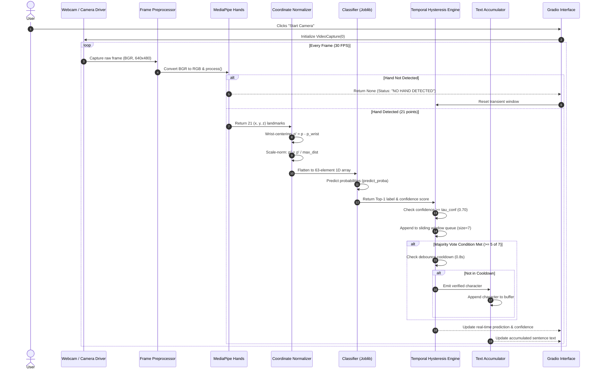
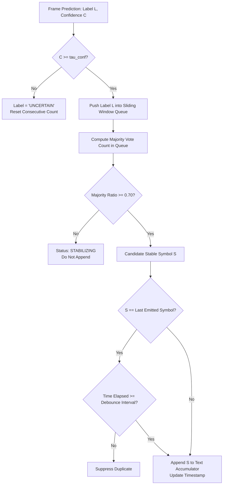
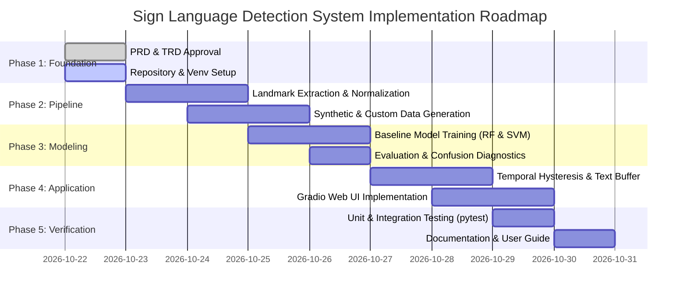

# Technical Requirements Document (TRD)

**Project Name:** Sign Language Detection and Recognition System  
**Document Type:** Technical Requirements Document (TRD)  
**Version:** 1.0  
**Status:** Approved for MVP Implementation  
**Primary Language & Frameworks:** Python 3.10+, OpenCV, MediaPipe Hands, scikit-learn, Gradio  
**Target Architecture:** Modular Pipeline (Local-First Edge Inference)  

---

## A. Technical Architecture

### 1. High-Level System Architecture
The system executes a strictly decoupled, sequential inference and buffering pipeline designed for real-time edge execution:

$$\text{Video/Image Input} \longrightarrow \text{Frame Processor} \longrightarrow \text{MediaPipe Hands} \longrightarrow \text{Coordinate Normalizer} \longrightarrow \text{ML Classifier} \longrightarrow \text{Confidence Gating} \longrightarrow \text{Temporal Hysteresis} \longrightarrow \text{Text Builder} \longrightarrow \text{Gradio UI}$$

```mermaid
flowchart LR
    subgraph Input_Layer ["Input Layer"]
        A1[Webcam Stream 640x480] 
        A2[Static Image Upload]
    end

    subgraph Vision_Pipeline ["Computer Vision Pipeline"]
        B[Frame Processor\nRGB Conversion & Resizing]
        C[MediaPipe Hands\n21 3D Landmarks Detector]
        D[Feature Extractor\nOrigin-Centered & Scale-Normalized Vector]
    end

    subgraph Inference_Engine ["Inference & Logic Layer"]
        E[Model Inference Service\nRandom Forest / SVM Classifier]
        F[Confidence Filter\nThreshold tau_conf = 0.70]
        G[Temporal Hysteresis Filter\nSliding Window Majority Voting]
        H[Duplicate Suppressor\nDebounce Cooldown Engine]
        I[Text Accumulator\nWord & Sentence Builder]
    end

    subgraph Presentation_Layer ["Presentation Layer"]
        J[Gradio Web UI\nLive Feed, Diagnostics & Controls]
        K[Visual Skeleton Overlay\nOptional Debug Renderer]
    end

    A1 --> B
    A2 --> B
    B --> C
    C -->|Detected Landmarks| D
    C -.->|Landmark Coordinates| K
    D -->|63-dim Normalized Vector| E
    E -->|Class Probs & Top Label| F
    F -->|Gated Predictions| G
    G -->|Stable Symbol| H
    H -->|Verified New Letter| I
    I --> J
    K --> J
    F -.->|Status & Confidence| J
```



### 2. Component Responsibilities & Interface Specifications

| Component | Class / Module | Primary Responsibility | Input Contract | Output Contract |
| :--- | :--- | :--- | :--- | :--- |
| **Frame Processor** | `src.preprocessing.FrameProcessor` | Frame resizing, color conversion (BGR $\rightarrow$ RGB), orientation check. | `np.ndarray` ($H \times W \times 3$, `uint8`, BGR) | `np.ndarray` ($480 \times 640 \times 3$, `uint8`, RGB) |
| **Hand Detector** | `src.feature_extraction.HandLandmarkDetector` | Detects hand presence, locates bounding box, extracts 21 3D keypoints. | RGB frame (`np.ndarray`) | `Optional[mp_landmarks]` (21 $(x,y,z)$ coordinates) |
| **Feature Normalizer** | `src.preprocessing.LandmarkNormalizer` | Translates coordinates to wrist origin; scales by maximum Euclidean distance. | Raw landmarks array ($21 \times 3$) | Flattened normalized vector $\mathbf{x} \in \mathbb{R}^{63}$ |
| **Model Service** | `src.models.SignClassifier` | Encapsulates trained estimator; computes class logits and calibrated probabilities. | Feature vector $\mathbf{x} \in \mathbb{R}^{63}$ | `PredictionResult(label, confidence, all_probs)` |
| **Confidence Filter** | `src.prediction_smoothing.ConfidenceFilter` | Rejects predictions falling below configured confidence threshold $\tau_{\text{conf}}$. | `PredictionResult` | `FilteredPrediction(label, confidence, is_valid)` |
| **Temporal Filter** | `src.prediction_smoothing.TemporalFilter` | Buffers window of $N$ frames; applies majority voting to eliminate frame jitter. | Stream of `FilteredPrediction` | `Optional[str]` (Stable accepted character) |
| **Duplicate Suppressor** | `src.prediction_smoothing.DuplicateSuppressor` | Enforces minimum time interval before allowing the same character to repeat. | Stable character string | `Optional[str]` (Debounced character) |
| **Text Accumulator** | `src.text_builder.TextAccumulator` | Manages string state, handles character appends, spaces, backspaces, and resets. | Debounced character string | `str` (Full accumulated sentence) |
| **User Interface** | `ui.gradio_app.GradioSignApp` | Renders web UI, handles user clicks, provides visual diagnostics. | Video stream & state updates | Interactive browser interface |

### 3. Detailed Data Flow Diagram



---

## B. Technology Stack & Justification

### 1. Technology Evaluation Matrix

| Category | Candidate Technology | Pros | Cons | Final Decision |
| :--- | :--- | :--- | :--- | :--- |
| **Core Runtime** | **Python 3.10 - 3.12** | Universal ML ecosystem, high cross-platform compatibility. | Slower execution than C++ (mitigated by NumPy/C extensions). | **Selected (Standard)** |
| **Computer Vision** | **OpenCV (`opencv-python`)** | Fast C++ backend, standard camera capture, robust image manipulation. | High-level GUI module (`cv2.imshow`) is dated and not web-accessible. | **Selected (I/O & Processing)** |
| **Landmark Detection**| **MediaPipe Hands** | Lightweight real-time 3D landmark localization on CPU, pre-trained, cross-platform. | Sensitive to extreme backlighting and occlusion. | **Selected (Primary Feature Extractor)** |
| **Data & Tensors** | **NumPy & Pandas** | High-performance array operations, standard data structures. | None for tabular data. | **Selected** |
| **Machine Learning** | **scikit-learn** | Highly optimized Random Forest and SVM implementations; easy serialization via `joblib`. | Limited to tabular/landmark data (cannot train 3D CNNs directly). | **Selected (Primary MVP Classifier)** |
| **Deep Learning** | **PyTorch** | Flexible, dynamic computation graphs for sequence modeling (LSTM, Transformer). | Larger dependency footprint; unnecessary overhead for static MVP. | **Deferred to Phase 2 (Dynamic Signs)** |
| **UI Framework** | **Gradio** | Built-in webcam streaming, image dropboxes, reactive sliders, accessible web DOM. | Minor streaming latency compared to raw C++ desktop windows. | **Selected (Primary Application UI)** |
| **Testing** | **pytest** | Expressive fixtures, parameterization, standard test runner. | None. | **Selected** |

### 2. Recommended MVP Technology Stack
- **Language:** Python 3.10+
- **Vision I/O:** OpenCV (`opencv-python>=4.8.0`)
- **Keypoint Extraction:** Google MediaPipe Hands (`mediapipe>=0.10.9`)
- **Feature Math:** NumPy (`numpy>=1.26.0,<3.0.0`)
- **Classification Engine:** scikit-learn (`scikit-learn>=1.3.0`, `joblib>=1.3.0`)
- **Frontend / Interface:** Gradio (`gradio>=4.20.0`)
- **Test Suite:** pytest (`pytest>=7.4.0`)
- **Visual Diagnostics:** Matplotlib & Seaborn (`matplotlib>=3.7.0`, `seaborn>=0.12.0`)

---

## C. Dataset Strategy & Linguistic Grounding

### 1. Target Sign Language Definition
- **Selected Language:** American Sign Language (ASL) fingerspelling.
- **Alphabet Scope:** 24 static letters (`A, B, C, D, E, F, G, H, I, K, L, M, N, O, P, Q, R, S, T, U, V, W, X, Y`).
- **Linguistic Separation from Other Sign Languages:**
  - **Pakistan Sign Language (PSL):** PSL utilizes an Urdu-based alphabet comprising 37+ distinct characters, frequently employs two-handed formations, and has entirely distinct phonological configurations. ASL models **cannot** and **must not** be used for PSL.
  - **British Sign Language (BSL):** BSL fingerspelling is strictly two-handed (where the dominant index finger touches locations on the non-dominant palm to represent vowels), making single-hand ASL classifiers completely incompatible.

### 2. Public Dataset Evaluation

| Dataset | Source / Reference | Format & Size | Classes | Permitted Use | Suitability & Limitations |
| :--- | :--- | :--- | :--- | :--- | :--- |
| **Sign Language MNIST** | Kaggle (`datamunge/sign-language-mnist`) | $28 \times 28$ grayscale CSV pixels; 27,455 train, 7,172 test | 24 static letters (No J/Z) | CC0 Public Domain | **Exploratory Baselines Only.** Severe domain gap from real webcams; low resolution destroys joint clarity. |
| **ASL Alphabet Dataset** | Kaggle (`grassknoted/asl-alphabet`) | $200 \times 200$ RGB images; 87,000 samples | 29 classes (A-Z, Space, Del, Nothing) | CC BY-SA 4.0 | **Good for Image Baseline.** Controlled backgrounds; potential signer overlap between splits. |
| **WLASL** | Li et al., WACV 2020 (`dxli94/WLASL`) | HD Video clips; ~21,000 clips, 100+ signers | 2,000 word glosses | Academic / Non-commercial | **Reserved for Future Phase.** Word-level dynamic signs; overkill for static alphabet MVP. |
| **PSL OpenPose Dataset** | LUMS CHISEL / Saad Butt et al. | Keypoints & Images; ~2,000 images | 37 Urdu letters + 12 words | Research Use | **Dedicated PSL Target.** Mandatory if the project pivots to Pakistan Sign Language. |

### 3. Primary Dataset Architecture: Direct-Inference Landmark Dataset
To eliminate the severe domain gap between external static image datasets and the real-time MediaPipe webcam pipeline, the primary MVP training set is constructed using **extracted, normalized MediaPipe landmark vectors**.

#### Collection Protocol:
- **Signer Diversity:** Minimum 3 distinct signers (target 5–8) with varied hand morphologies, skin tones, and arm lengths.
- **Environmental Variance:** Data collected across 3 lighting setups (direct warm light, diffuse daylight, low indoor light) and 2 background environments (plain wall, cluttered home office).
- **Sample Distribution:** 50 stable frames per class per signer $\times 24$ classes $\times 4$ signers $\approx 4,800$ landmark vectors.
- **Privacy Enforcement:** Raw video frames are discarded immediately after landmark extraction during collection, preserving biometric anonymity.

### 4. Signer-Independent Split Strategy
To rigorously measure generalization and prevent data leakage:
- **Signer-Independent Split (Gold Standard):** Signers 1, 2, and 3 are assigned strictly to the **Training Set (70%)** and **Validation Set (15%)**. Signer 4 is held out exclusively for the **Test Set (15%)**.
- **Rule:** If signer-independent splitting is impossible due to single-user data collection, partition data strictly by distinct recording sessions separated by time and clothing/lighting changes. This limitation must be explicitly disclosed in the model card.

---

## D. Data Preprocessing & Feature Engineering

### 1. MediaPipe 21-Landmark Topology
MediaPipe Hands outputs 21 3D landmarks ($P_0$ through $P_{20}$):
- `0`: Wrist
- `1-4`: Thumb (CMC, MCP, IP, TIP)
- `5-8`: Index finger (MCP, PIP, DIP, TIP)
- `9-12`: Middle finger (MCP, PIP, DIP, TIP)
- `13-16`: Ring finger (MCP, PIP, DIP, TIP)
- `17-20`: Pinky finger (MCP, PIP, DIP, TIP)

```
          8 (INDEX_TIP)     12 (MIDDLE_TIP)    16 (RING_TIP)      20 (PINKY_TIP)
             |                 |                  |                  |
          7 (INDEX_DIP)     11 (MIDDLE_DIP)    15 (RING_DIP)      19 (PINKY_DIP)
             |                 |                  |                  |
          6 (INDEX_PIP)     10 (MIDDLE_PIP)    14 (RING_PIP)      18 (PINKY_PIP)
             |                 |                  |                  |
 4 (THUMB) 5 (INDEX_MCP)     9 (MIDDLE_MCP)    13 (RING_MCP)      17 (PINKY_MCP)
   \         \                 |                  /                  /
    3 (IP)    \________________|_________________/                  /
     \                         |                                   /
      2 (MCP)                  |                                  /
       \                       |                                 /
        1 (CMC)                |                                /
         \                     |                               /
          \____________________0 (WRIST)______________________/
```

### 2. Mathematical Coordinate Normalization
Raw MediaPipe screen coordinates ($x, y \in [0, 1]$ relative to image bounds, $z$ relative to wrist) change drastically when the user shifts position or moves closer to the camera. We apply a three-step invariant transformation:

#### Step 1: Translation Invariance (Wrist Centering)
Translate all 21 landmarks such that the Wrist ($P_0$) lies exactly at the coordinate origin $(0, 0, 0)$:

$$P'_i = P_i - P_0 = \begin{bmatrix} x_i - x_0 \\ y_i - y_0 \\ z_i - z_0 \end{bmatrix}, \quad \forall i \in \{0, 1, \dots, 20\}$$

*Result:* $P'_0 = (0, 0, 0)$.

#### Step 2: Scale Invariance (Euclidean Bound Scaling)
Compute the maximum Euclidean distance from the origin to any landmark:

$$d_{\max} = \max_{i \in \{1, \dots, 20\}} \|P'_i\|_2 = \max_{i} \sqrt{(x'_i)^2 + (y'_i)^2 + (z'_i)^2}$$

Scale all coordinates by $d_{\max}$ with a small numerical epsilon ($\epsilon = 10^{-7}$):

$$P''_i = \frac{P'_i}{d_{\max} + \epsilon}, \quad \forall i \in \{0, 1, \dots, 20\}$$

*Result:* All landmark coordinates are strictly bounded within the unit sphere ($\|P''_i\|_2 \le 1.0$), making features completely invariant to distance from the camera.

#### Step 3: Feature Vector Flattening
Flatten the 21 normalized 3D coordinates into a 1D feature vector:

$$\mathbf{x} = \big[ x''_0, y''_0, z''_0, x''_1, y''_1, z''_1, \dots, x''_{20}, y''_{20}, z''_{20} \big]^T \in \mathbb{R}^{63}$$

### 3. Data Augmentation for Landmarks
To bolster model robustness without generating anatomically invalid configurations:
1. **Gaussian Jitter:** Add zero-mean Gaussian noise $\mathcal{N}(0, \sigma^2)$ where $\sigma = 0.015$ to simulate natural hand tremor.
2. **Random Uniform Scaling:** Scale coordinates by a factor $\alpha \sim \mathcal{U}(0.90, 1.10)$ to simulate variation in finger length.
3. **In-Plane Rotation:** Apply random 2D rotation matrix $R(\theta)$ around the wrist for small tilt angles $\theta \sim \mathcal{U}(-12^\circ, +12^\circ)$:

$$R(\theta) = \begin{bmatrix} \cos\theta & -\sin\theta \\ \sin\theta & \cos\theta \end{bmatrix}$$

---

## E. Model Selection and Comparison

### 1. Comparative Architecture Analysis

| Dimension | Approach 1: Classical ML (Random Forest / SVM) | Approach 2: Landmark Multi-Layer Perceptron (MLP) | Approach 3: Spatiotemporal Sequence Model (GRU/LSTM) |
| :--- | :--- | :--- | :--- |
| **Input Representation** | 63-element normalized landmark vector ($\mathbb{R}^{63}$) | 63-element normalized landmark vector ($\mathbb{R}^{63}$) | Sequence of landmark vectors ($T \times 63$, $T=30$) |
| **Core Architecture** | Ensemble of 150 Decision Trees or RBF Kernel SVM | 3-layer Dense Network (63 $\rightarrow$ 128 $\rightarrow$ 64 $\rightarrow$ 24) with ReLU & Dropout | 2-layer Bidirectional GRU (hidden=128) + Linear head |
| **Parameters** | Non-parametric / ~1.2 MB on disk | ~20,000 parameters / ~100 KB on disk | ~250,000 parameters / ~1.5 MB on disk |
| **Training Time** | $< 15\text{ seconds}$ on CPU | $< 2\text{ minutes}$ on CPU | $15 - 30\text{ minutes}$ on GPU |
| **Inference Latency** | **$0.4 - 1.2\text{ ms}$ (Ultra-fast)** | **$1.8 - 3.5\text{ ms}$ (Fast)** | **$12 - 25\text{ ms}$ (Moderate)** |
| **Sample Efficiency** | Very high (trains reliably on 30 samples/class) | Moderate (requires $\ge 100$ samples/class) | Low (requires $\ge 500$ video clips/class) |
| **Overfitting Risk** | Low (mitigated by `max_depth` and `min_samples_leaf`) | Moderate (requires Dropout and Weight Decay) | High without extensive temporal regularization |
| **MVP Suitability** | **Highest (Recommended Baseline)** | **High (Advanced Static Alternative)** | **Low for MVP (Deferred to Dynamic Phase)** |

### 2. Decision Justification
- **Primary MVP Baseline:** **Random Forest Classifier** (`n_estimators=150`, `max_depth=16`). It provides deterministic multi-class probability estimation, handles non-linear feature interactions, trains in seconds on commodity laptops, and produces zero gradient instability.
- **Secondary Static Alternative:** **Support Vector Machine (SVM)** with RBF kernel and Platt probability calibration (`probability=True`). Provides optimal margin separation on boundary cases (e.g., distinguishing `'M'` vs. `'N'`).
- **Deep Learning Sequence Models:** Deferred to Phase 2. Attempting sequence modeling before stabilizing static landmark extraction introduces unnecessary failure points and compute overhead.

---

## F. Model Training Pipeline & Reproducibility

```mermaid
flowchart TD
    A[Raw Landmark CSV / Numpy Store] --> B[Data Integrity Validator\nNaN Check & Shape Verification]
    B --> C[Stratified Signer-Aware Splitter\nTrain 70% | Val 15% | Test 15%]
    C --> D[Synthetic Augmentation Engine\nJitter, Scale, 2D Rotation]
    D --> E[Model Trainer\nGridSearchCV / Random Forest Fitting]
    E --> F[Validation Check\nMacro-F1 & Class Confusion Analysis]
    F -->|Pass: F1 >= 0.85| G[Calibrate Probabilities\nPlatt Scaling / Isotonic]
    F -->|Fail: F1 < 0.85| H[Hyperparameter Retuning]
    G --> I[Model Serializer\nExport model.joblib + metadata.json]
    I --> J[Held-Out Test Set Evaluation\nFinal Unbiased Benchmark Report]
```

### 1. Training Configuration Schema (`config.py`)
All training parameters are strictly version-controlled via Python dataclasses:

```python
from dataclasses import dataclass, field
from typing import List

@dataclass
class TrainingConfig:
    random_seed: int = 42
    test_size: float = 0.15
    val_size: float = 0.15
    n_estimators: int = 150
    max_depth: int = 16
    min_samples_split: int = 4
    min_samples_leaf: int = 2
    confidence_threshold: float = 0.70
    classes: List[str] = field(default_factory=lambda: [
        'A', 'B', 'C', 'D', 'E', 'F', 'G', 'H', 'I', 'K',
        'L', 'M', 'N', 'O', 'P', 'Q', 'R', 'S', 'T', 'U',
        'V', 'W', 'X', 'Y'
    ])
```

### 2. Model Artifact Packaging
The trained model package saved to `models/` must contain:
1. `classifier.joblib`: Serialized scikit-learn estimator pipeline.
2. `class_names.json`: Ordered list of 24 class strings.
3. `metadata.json`: Timestamp, scikit-learn version, input dimension ($63$), validation Macro-F1 score, and git commit hash.
4. `feature_metadata.json`: Feature column names (`wrist_x`, `wrist_y`, etc.) and normalization parameters.

---

## G. Evaluation Strategy & Metrics

### 1. Metric Formulations
Because sign datasets may exhibit subtle frequency imbalances, accuracy alone is insufficient.

- **Top-1 Accuracy:**

$$\text{Accuracy} = \frac{\sum_{c=1}^C \text{TP}_c}{\sum_{c=1}^C (\text{TP}_c + \text{FP}_c + \text{FN}_c)}$$

- **Macro-Averaged F1 Score (Primary Optimization Target):**

$$\text{Macro-F1} = \frac{1}{C} \sum_{c=1}^C \frac{2 \cdot \text{Precision}_c \cdot \text{Recall}_c}{\text{Precision}_c + \text{Recall}_c}$$

- **False Acceptance Rate (FAR) for Unsupported Inputs:**
Given a negative dataset $D_{\text{neg}}$ of resting hands and unsupported gestures:

$$\text{FAR} = \frac{|\{x \in D_{\text{neg}} : \max_c P(y=c|x) \ge \tau_{\text{conf}}\}|}{|D_{\text{neg}}|}$$

Target: $\text{FAR} \le 5.0\%$.

### 2. Confusion Analysis for Structurally Similar Letters
The evaluation pipeline must compute and render a normalized confusion matrix highlighting phonologically adjacent pairs:
- **`'A'` vs `'S'` vs `'E'` vs `'T'`:** All involve closed fists with differing thumb placements (beside index, over fingers, curled under, tucked between index and middle).
- **`'M'` vs `'N'`:** Differ only by whether the thumb is tucked beneath 3 fingers or 2 fingers.
- **`'K'` vs `'V'`:** Differ only by thumb resting on the middle finger knuckle.

---

## H. Real-Time Inference & Temporal Smoothing Engine

### 1. The Per-Frame Flicker Problem
If every video frame is processed independently into text, a signer holding the letter `'B'` for 1.5 seconds at 30 FPS will generate 45 consecutive `'B'` characters (`"BBBBBBBBBB..."`). Furthermore, during transition hand movements (moving from `'B'` to `'A'`), transient intermediate hand configurations will generate spurious random letters.

### 2. Multi-Stage Hysteresis Algorithm



### 3. Parameters
- **Sliding Window Size ($W$):** 7 frames.
- **Majority Agreement Threshold ($M$):** $\ge 5$ of 7 frames ($71.4\%$).
- **Confidence Cutoff ($\tau_{\text{conf}}$):** $0.70$.
- **Duplicate Debounce Interval ($T_{\text{debounce}}$):** $0.80\text{ seconds}$.
- **No-Hand Reset:** If MediaPipe reports no hand for $\ge 3$ consecutive frames, clear the sliding window immediately.

---

## I. API and Module Design

```
sign-language-detector/
├── .venv/                      # Isolated virtual environment
├── data/
│   ├── raw/                    # Raw collected landmark recordings
│   └── processed/              # Normalized train/val/test splits
├── docs/
│   ├── PRD.md                  # Product Requirements Document
│   └── TRD.md                  # Technical Requirements Document
├── models/
│   ├── classifier.joblib       # Serialized Random Forest / SVM
│   ├── class_names.json        # Class label mapping
│   └── metadata.json           # Model training metrics & parameters
├── src/
│   ├── __init__.py
│   ├── config.py               # Central configuration & hyperparameters
│   ├── feature_extraction.py   # MediaPipe Hands 21-landmark extractor
│   ├── preprocessing.py        # Coordinate centering & scale normalizer
│   ├── models.py               # Model wrappers & serialization
│   ├── prediction_smoothing.py # Sliding window & hysteresis engine
│   ├── text_builder.py         # Word/sentence accumulator & spacing
│   ├── data_collection.py      # Camera landmark capture utility
│   ├── synthetic_data.py       # High-fidelity synthetic dataset generator
│   ├── train_model.py          # Training pipeline & evaluation export
│   ├── evaluate_model.py       # Test suite, confusion matrix & metrics
│   └── inference.py            # Unified end-to-end inference engine
├── ui/
│   ├── __init__.py
│   └── gradio_app.py           # Gradio web user interface
├── tests/
│   ├── __init__.py
│   ├── test_preprocessing.py   # Landmark normalization math tests
│   ├── test_smoothing.py       # Sliding window & debounce tests
│   ├── test_text_builder.py    # Text formatting & reset tests
│   └── test_inference.py       # Pipeline end-to-end integration tests
├── app.py                      # Main entry point CLI / Launcher
├── requirements.txt            # Pinned dependencies
└── README.md                   # Project manual & setup guide
```

---

## J. Deployment & Environment Specification

### 1. Local Python Environment Setup
```bash
# 1. Create and activate virtual environment
python -m venv .venv
# Windows:
.venv\Scripts\activate
# Linux/macOS:
source .venv/bin/activate

# 2. Install dependencies
pip install -r requirements.txt

# 3. Verify installation and run tests
pytest tests/ -v

# 4. Launch Application
python app.py --mode web
```

### 2. Runtime Hardware Footprint
- **CPU:** Standard 2.0 GHz quad-core processor (Intel Core i5 8th Gen / AMD Ryzen 3500U or newer).
- **RAM:** Minimum 4 GB system memory (application requires $< 650\text{ MB}$).
- **Camera:** Standard internal or USB 2.0 webcam ($640 \times 480$ at 30 FPS).
- **GPU:** Optional; not required for CPU landmark inference.

---

## K. Security, Biometric Privacy & Ethics

1. **Biometric Data Protection:** Hand geometry and landmarks can constitute biometric identifiers under certain jurisdictions (e.g., GDPR, CCPA). The system operates on a **zero-retention, local-only policy**: raw video frames are processed in volatile RAM and immediately overwritten.
2. **Informed Consent Protocol:** Any custom landmark datasets collected for training must be accompanied by written informed consent specifying non-commercial educational use and voluntary withdrawal rights.
3. **Interpreter Replacement Disclaimer:** The UI must display an unmissable disclaimer stating:  
   > *“NOTICE: This software is an experimental educational prototype for static fingerspelling recognition. It does NOT translate natural sign language conversation and must NEVER be used as a replacement for qualified sign language interpreters in medical, legal, or emergency situations.”*

---

## L. Risk Register & Mitigation Matrix

| Risk ID | Risk Description | Likelihood | Impact | Mitigation Strategy | Contingency Plan |
| :---: | :--- | :---: | :---: | :--- | :--- |
| **R-01** | High prediction confusion between similar fist letters (`A`, `E`, `M`, `N`, `S`, `T`). | High | Medium | Incorporate thumb-tip distance features relative to index/middle base knuckles. | Mark low-margin predictions as `UNCERTAIN`; display top-2 candidates in UI. |
| **R-02** | Poor generalization across unrepresented skin tones or lighting conditions. | High | High | Rely on MediaPipe landmark extraction (invariant to skin color after hand detection) and scale-invariant normalization. | Provide UI illumination warnings; test across diverse lighting setups. |
| **R-03** | Missing or faulty webcam driver crashes application. | Medium | High | Wrap `cv2.VideoCapture` in a resilient context manager with fallback to Static Image Upload mode. | Display actionable setup prompt in the Gradio web interface. |
| **R-04** | Frame rate drops below 10 FPS on low-power student laptops. | Medium | Medium | Downsample input frames to $480 \times 360$; skip landmark extraction on alternating frames if hand position is stationary. | Enable lightweight model inference profile in `config.py`. |
| **R-05** | Ethical harm from users overestimating system translation capabilities. | Medium | High | Strict feature scoping; prominent UI disclaimers; no claims of fluent continuous translation. | Restrict vocabulary documentation strictly to isolated fingerspelling. |

---

## M. Implementation Roadmap



| Phase | Core Deliverables | Target Milestone |
| :--- | :--- | :--- |
| **Phase 1: Specs & Setup** | Approved PRD, TRD, virtual environment, dependency lock. | Environment initialized with zero conflicts. |
| **Phase 2: Data & Vision** | `feature_extraction.py`, `preprocessing.py`, landmark datasets. | 21 3D landmarks reliably extracted and normalized. |
| **Phase 3: Model Training** | `models.py`, `train_model.py`, `models/classifier.joblib`. | Macro-F1 $\ge 0.85$ achieved on validation split. |
| **Phase 4: Real-Time Engine**| `prediction_smoothing.py`, `text_builder.py`, `inference.py`. | Zero jitter; duplicate suppression operating at 0.8s debounce. |
| **Phase 5: Web UI & Demo** | `ui/gradio_app.py`, `app.py`, test suite passing, README. | End-to-end interactive system operational. |
